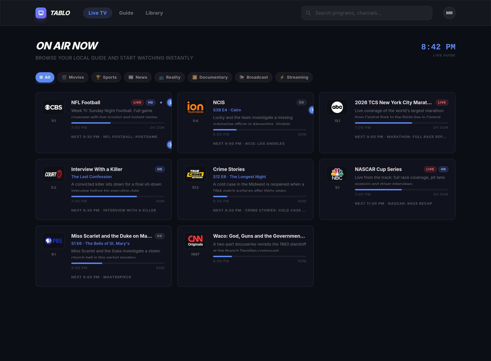
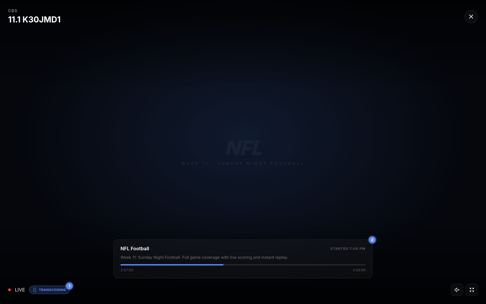
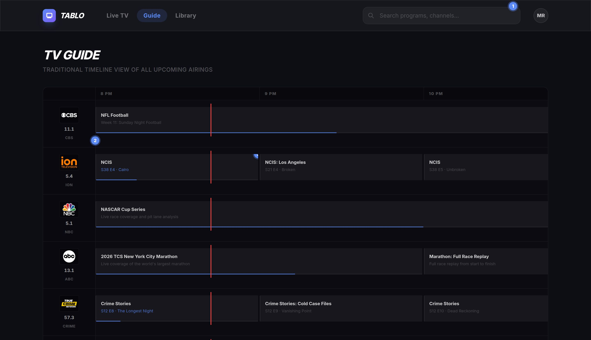
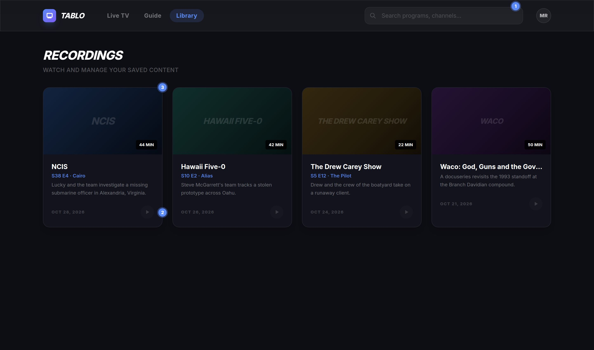

# Implementation Plan: Priority Groups 1 and 2

Source of truth for the gaps: [`docs/presentation-gaps.md`](./presentation-gaps.md). This plan covers the ten gaps in Groups 1 and 2: **G1, G2, G3, G4, G5** (backend passthrough) and **G7, G10, G11, G14, G15** (frontend quick wins). Group 3 (G6, G8, G9, G12, G13-full) is out of scope.

## Problem statement

The UI silently drops metadata the Tablo device already returns: episode identity, qualifiers, channel resolution/favourite/flags, and the next airing. The backend's `state.py` maps every device response to a small fixed row shape and discards the rest, and the frontend then holds data it never renders (the player receives no program info; the header search hides itself on two of three tabs). The fix is two thin layers: a passthrough PR over the row shapes in `state.py`, then frontend rendering of the new fields.

## Locked decisions

Decisions made up front so implementation does not reopen scope:

1. **Order deviates from the report's group order.** The backend PR (Group 2) lands first, because G11's "what's next" line needs a `next_program` field from the guide endpoint, and the frontend types depend on the final row shapes. Group 1's pure-frontend items (G7, G10, G14, G15) then land on top.
2. **G14 search is one shared input.** The existing header search in `ChannelGrid.tsx` is shown on all three tabs (drop the `activeTab === "live"` condition) and its `filter` string is passed as a prop to `GuideGridView` and `LibraryView`. No new per-view search boxes.
3. **G5 genre strategy: derive from `event_type`.** A single backend helper maps `movieAiring` → `["Movies"]`, `sportEvent` → `["Sports"]`, `newsEvent` → `["News"]` when the device supplies no `genres` (OTA never does; verified live). Reality/Documentary remain OTT-only and are documented as such. No title-keyword heuristics.
4. **G3 is badges only.** HD and favorite indicators render; channels are not re-sorted by favorite status (sorting changes muscle memory; defer).
5. **G7 uses the start response only.** The `transcoded` flag already exists on `StreamStart`. No polling of `/api/transcode/status/{sid}` in this pass (deferred to Group 3 follow-up).
6. **G4 thumbnail is best-effort.** `thumbnail` resolves from `episode.image` or `series.image` if present, else stays `null`. The live device currently has no recordings, so the image keys are guarded, not assumed.
7. **Filter logic moves to `frontend/src/lib/filters.ts`.** `matchesContentFilter`, `airingMatchesFilter`, and `channelMatchesFilter` are currently duplicated in `ChannelGrid.tsx`, `GuideGridView.tsx`, and `__tests__/filters.test.ts` (the test file says so in a comment). Extract once; import everywhere.

## Wireframes (for review)

Four token-accurate mockups of the affected screens, built from the real app chrome (design tokens from `tailwind.config.js`, real channel logos and program data from the live device). Numbered blue dots mark what is new; everything else is the existing UI unchanged. HTML sources are in [`wireframes/group1-2/`](./wireframes/group1-2/) if you want to tweak a mock before approval.

### 1. Live tab: channel cards (G1, G2, G3, G11)



- **1**: Episode line under the title: `S38 E4 · Cairo` when season/number are present, episode title alone otherwise (COURT card), nothing for sports/movies without episode data.
- **2**: Qualifier badge row: `LIVE` (qualifier), `CC` (closed captions), `HD` (resolution), `★` (favourite). OTA-only; OTT cards show no badges.
- **3**: "What's next" line from the new `next_program` field; omitted when null (OTT card, bottom right).

### 2. Player: now-playing bar and transcoding chip (G10, G7)



- **1**: `TRANSCODING` chip next to LIVE, shown from the `transcoded` flag on the stream-start response (no polling).
- **2**: Now-playing bar: program title, description, start time, and a progress bar with elapsed/total. Data arrives via the `current_program` field added to the player payload in `ChannelGrid.handlePlay`.

### 3. Guide tab: search, channel column, episode titles (G14, G15, G1)



- **1**: The shared header search, now visible on the Guide tab (and Library) instead of Live only.
- **2**: Network line under the channel number in the channel column.
- **3**: Episode title inline in airing buttons (replaces the description line when present).

### 4. Library: search, S/E line, dead play button (G14, G4, G13)



- **1**: Shared header search on the Library tab.
- **2**: Play button stays disabled (playback is Group 3) with a "Playback coming soon" tooltip; the card is otherwise fully populated.
- **3**: S/E line under the title from the new recording fields; omitted for movies without episode data (Waco card).

## Phase 1: backend passthrough (`backend/app/state.py`)

All device field names below were verified against the live device on 2026-11-11.

### 1.1 Episode identity and qualifiers (G1, G2)

Add a small helper next to the existing enrichment code:

```python
def _episode_fields(data: dict) -> dict:
    ep = data.get("episode") or {}
    return {
        "episode_title": ep.get("title"),
        "season_number": ep.get("season_number") or 0,
        "episode_number": ep.get("number") or 0,
    }
```

Merge it into the program dict at the three OTA airing-parsing sites, plus `qualifiers`:

- `_fetch_guide_enrichment_local`, `channel_airing_map` value (~L328)
- `_fetch_guide_enrichment`, `channel_airing_map` value (~L414)
- `_build_grid_enrichment`, `channel_to_airings` entries (~L643)

Each becomes:

```python
{
    "title": ad.get("show_title"),
    "description": ...,
    "start": ...,
    "duration": ...,
    "genres": ...,            # see 1.4
    "kind": ad.get("event_type"),
    "qualifiers": ad.get("qualifiers") or [],
    **_episode_fields(a),
}
```

Cloud airings (`_fetch_cloud_airings`, ~L245) get the same keys via `.get` guards, since the cloud payload shape is not verified live.

### 1.2 Channel attributes (G3)

In `_fetch_guide_enrichment_local` (~L298-310), where `detail_results` are already parsed for logos, also build:

```python
channel_attrs: dict = {}   # identifier -> {"resolution", "favourite", "flags"}
```

from `c_info.get("resolution")`, `c_info.get("favourite")`, `c_info.get("flags")`. Return it as an extra element of the enrichment tuple (and mirror in `_build_grid_enrichment`'s own detail fetch, ~L597-630). Thread it through:

- `get_guide_data` row (~L444): add `"resolution"`, `"favourite"`, `"flags"` from `channel_attrs.get(c.identifier, {})`.
- `_assemble_grid_row` (~L659): same three keys.

The grid cache stores the enrichment tuple, not rows, so the cached shape changes in memory only; nothing persists. OTA-only in practice: OTT channels without a local guide path get `null`s, which the UI must tolerate.

### 1.3 Recording S/E and thumbnail (G4)

`get_recordings` (~L547): add `**_episode_fields(data)` and change the thumbnail line to:

```python
"thumbnail": (data.get("episode") or {}).get("image")
             or (data.get("series") or {}).get("image")
             or None,
```

### 1.4 Genre derivation (G5)

```python
_EVENT_GENRES = {"movieAiring": ["Movies"], "sportEvent": ["Sports"], "newsEvent": ["News"]}

def _genres_for(ad: dict) -> list:
    return ad.get("genres") or _EVENT_GENRES.get(ad.get("event_type"), [])
```

Use `_genres_for(ad)` at the three sites in 1.1 instead of `ad.get("genres") or []`. Frontend filter logic is unchanged: Movies and Sports already match on `kind`, so this makes the genre array consistent rather than empty.

### 1.5 Next airing for the live guide (G11 backend half)

In `_fetch_guide_enrichment_local` (~L312-337), the loop already sees every fetched airing with start and duration. Alongside `channel_airing_map`, build `channel_next_map`: for each `c_path`, the airing with the smallest `start` strictly after `now`, selected by a small pure helper `_next_airing(airings, now)` so it is unit-testable without the fetch loop (see Tests). Return it as an extra tuple element. `get_guide_data` and `stream_guide_data` add `"next_program": channel_next_map.get(c_path)` (title, start, duration, plus episode/qualifier fields) to each row. OTT channels get `null` (the cloud fetch only retrieves the current airing).


## Phase 2: frontend (`frontend/src`)

### 2.1 Types (`api/tablo.ts`)

Extend the existing interfaces; no new parallel types:

- `Program`: add `episode_title?: string | null; season_number?: number; episode_number?: number; qualifiers?: string[];`
- `GuideChannel`: add `resolution?: string | null; favourite?: boolean; flags?: string[]; next_program?: Program | null;` (`GridChannel` inherits these via `extends`.)
- `Recording`: add `episode_title?: string | null; season_number?: number; episode_number?: number;`
- `Channel` (player): add `logo_url?: string | null; current_program?: Program | null;`

### 2.2 G10: player now-playing bar (`VideoPlayer.tsx`, `ChannelGrid.tsx`)

`ChannelGrid.handlePlay` already builds `guideCh` with `logo_url` and `current_program`; the `<VideoPlayer channel={{...}}>` call (~L148) currently strips them. Pass the full object instead. In `VideoPlayer`, render a now-playing block in the bottom bar area: program title, one-line description, start time, and a progress bar driven by a 30-second `setInterval` while mounted (cleanup on unmount). Show it only when `channel.current_program` is present.

### 2.3 G7: transcoding chip (`VideoPlayer.tsx`)

The `startStream` `.then` already receives the full `StreamStart`; destructure `transcoded` into state and render a small "Transcoding" chip next to the existing LIVE badge when true. No new endpoint call (locked decision 5).

### 2.4 G11: "what's next" line (`ChannelCard.tsx`)

Below the progress bar, when `channel.next_program` is present: `Next: HH:MM · Title` using the same time formatting already in the file.

### 2.5 G14: search on all tabs (`ChannelGrid.tsx`, `GuideGridView.tsx`, `LibraryView.tsx`, new `lib/filters.ts`)

- Extract `matchesContentFilter` / `airingMatchesFilter` / `channelMatchesFilter` into `src/lib/filters.ts`; import in both views and in `__tests__/filters.test.ts` (replaces the replicated copies).
- Remove the `activeTab === "live"` condition around the header search so it shows on all tabs.
- Pass `search={filter}` to `GuideGridView` and `LibraryView`. Add a pure `matchesSearch` predicate per view in `lib/filters.ts`: grid rows match on call sign, network, display name, or any airing title; recordings match on title or description. Compose with the existing content filter.

### 2.6 G15: channel column identity (`GuideGridView.tsx`)

In the channel column (~L163-174), under the `major.minor` badge add one line: `{ch.network}` (plus call sign if it differs from network). Truncate, `text-white/30`.

### 2.7 G1 / G2 / G3 / G4 rendering

- `ChannelCard.tsx`: episode line when `episode_title` or numbers are present (`S{season} E{number} · {title}`, numbers-only fallback); qualifier badges (LIVE when `"live"` in qualifiers, CC when `"cc"`); HD badge when `resolution` starts with `hd`; star when `favourite`.
- Card layout: badges render inline in the title row (title truncates, chips are `shrink-0`), never in a separate row; card padding `p-5`, logo/content gap `gap-5`; vertical rhythm: `mb-1` after the title row, `mt-1` before the description, `mt-3` before the progress block and before the next line.
- Keep the display decisions in small exported pure functions (e.g. `episodeLine(program)`, `badgesFor(channel)`) rather than inline JSX conditionals, so the unit tests in Tests cover the rules without a component renderer.
- `GuideGridView.tsx`: episode title inline in the airing button title line when present.
- `LibraryView.tsx`: S/E line under the recording title when present; thumbnails render automatically once non-null (existing `rec.thumbnail` branch).
- Qualifier badge markup is used in two places; keep it as a small exported helper in `ChannelCard.tsx` rather than a new file.

### 2.8 G13 mitigation (dead play button)

`LibraryView.tsx` (~L61-65): give the play button `disabled` styling and a `title="Playback coming soon"` tooltip until recording playback lands in Group 3.

## Performance budget

Performance entropy is the accumulation of small costs that no single change feels responsible for: a few extra fields in a payload, a re-render per keystroke, a timer that outlives its component. None of this plan's changes are expensive at current scale (~100 channels, ≤300 channel detail + ≤800 airing detail fetches per enrichment, ~300 grid buttons). The budget is about keeping each new cost named, bounded, and measurable so the app does not quietly get slower over the next five PRs.

**Cost ledger** (every new cost this plan introduces, with its bound):

| Cost | Source | Bound |
|---|---|---|
| ~8 small fields per airing in NDJSON rows | G1, G2, G3, G11 | Payload grows a few percent; LAN transport; zero new requests |
| One extra reduced dict per channel in the live enrichment (`channel_next_map`) | G11 | ≤~100 small dicts, held for the 600s cache TTL |
| `next_program` lookup at row assembly | G11 | One dict lookup per channel, per stream |
| Filter recompute + grid re-render per keystroke | G14 | One O(n) pass per keystroke; ~100 rows live, ~300 buttons grid |
| One new 30s interval (player progress) | G10 | Cleared on unmount; touches one bar, video element untouched |
| Bundle: `lib/filters.ts` (moved, not added), badge helper, now-playing bar | all | No new npm dependencies; a few KB |

**Performance locks:**

1. **Zero new device calls.** All new fields (G1, G2, G3, G11) are extracted from responses the enrichment already fetches (`_fetch_guide_enrichment_local`, `_fetch_guide_enrichment`, `_build_grid_enrichment`), at the sites where the raw response is in memory. A cold guide load makes exactly the same device calls as today: 2 index + ≤300 channel details + ≤800 airing details + cloud.
2. **G11 reads only fetched data.** `channel_next_map` comes from the same airing fetch; if the current program is the last airing the device returned, `next_program` is `null`. The tempting future "improvement" is a per-channel follow-up fetch for the next airing (up to 800 extra calls); it stays deferred until measured.
3. **Extract once, store reduced, assemble by lookup.** New fields land in the reduced dicts at map-build time; `_assemble_grid_row` and `get_guide_data` do lookups only and never re-parse raw device responses. No second cache layer.
4. **Memoize the filtered lists.** `filtered` (ChannelGrid ~L115) and `filteredGrid` (GuideGridView ~L102) are plain `.filter()` calls today; G14 makes them run per keystroke. Wrap both in `useMemo` keyed on the data plus the filter inputs. LibraryView's list is small enough to stay inline. Reconciliation of ~100 rows per keystroke stays acceptable at current scale; debounce is not added until rows grow ~10x.
5. **One new timer.** The player's 30s progress clock (2.2) is the only new `setInterval` in the app, and it clears on unmount. The existing 60s grid clock, 5min refresh, and 3.5s controls-hide timers are untouched.
6. **Substring search only.** `matchesSearch` is a lowercase `includes` per row. No fuzzy-match library, no debounce dependency.
7. **Fields ride existing rows.** No extra NDJSON messages, no new endpoints, no client polling for any item in this plan. The EPG endpoint (15k airings, cache-bypassing) grows by the same per-airing fields; it is an XMLTV source, not the UI, and its size is checked in Validation.

**Pre-existing costs intentionally not touched** (fixing them here would mix concerns):

- `useGuideStream` re-renders once per NDJSON row (~200 renders per load). Batching would help but is a separate change.
- The grid tab opens its own NDJSON stream on mount; the backend cache makes it cheap, but two streams is a known wart.
- `get_epg_guide` bypasses the 600s cache and re-fetches up to 15k airing details on every call.

### 2.9 Styling per the design system

All new UI uses the existing theme tokens (`tailwind.config.js`) and the utilities in `index.css`. No new hex values, no new theme tokens, no icon library (inline SVG if an icon is needed), no new npm dependencies. The only inline `style` values are dynamic widths (progress bars), which is the established pattern. Full rules: [design-system.md](design-system.md).

| New element | Styling |
|---|---|
| Episode line (live card, library row) | `text-xs font-semibold text-accent/90 truncate` |
| Next line (live card) | `text-xs text-white/40 truncate` |
| Badge chips (LIVE, CC, HD) | inline in the title row (title truncates, chip `shrink-0`); `rounded bg-white/10 px-1.5 py-0.5 text-[10px] font-semibold uppercase tracking-wider text-white/60`; LIVE uses `bg-accent text-white` |
| Channel card spacing | padding `p-5`, logo/content gap `gap-5`; `mb-1` after the title row, `mt-1` before the description, `mt-3` before the progress block and before the next line |
| Favourite star (live card header) | inline SVG; `text-accent` when favourite, `text-white/30` otherwise |
| Grid channel network line | `text-xs text-white/40` |
| Player now-playing bar | in the existing bottom controls bar; title `text-sm font-medium text-white/80`, next line `text-xs text-white/50 truncate`, progress track `h-1 bg-white/20 rounded-full` with a `bg-accent` fill whose width is an inline `style` (brighter track than the card's `bg-white/5` because it sits over video) |
| Transcoding chip (2.3) | `rounded bg-white/10 px-2 py-0.5 text-[10px] font-semibold uppercase tracking-wider text-white/60`, next to the existing LIVE badge |
| Search input, genre pills | as specified in 2.8 (already theme utilities) |

## Edge cases and constraints

- **Episode fields are 0/null for movies and specials** (verified live: `number=0`, `title=null`). Render S/E only when `episode_title` is non-null or either number is > 0.
- **`qualifiers` can be null** on the device; always `or []` in the backend, `?? []` in the frontend.
- **OTT channels have no local guide path**, so `resolution`/`favourite`/`flags`/`next_program` are absent or null for them. All UI reads go through optional chaining; badges simply do not render.
- **NDJSON stub rows** (`stream_guide_data` Phase 1) carry none of the new fields. The client merge in `useGuideStream` already spreads incoming rows over existing ones, so enriched rows arrive with the full shape; no client change needed.
- **Grid play uses `airings[0]` as the player's program** (`handlePlay`). That airing may have started before the grid window; the player's progress calc clamps to 100, which is acceptable and noted here rather than fixed.
- **Grid cache tuple shape changes** (extra elements in Phase 1). The cache is in-memory with a 10-minute TTL; no persistence migration, but every unpack site must be updated in the same PR or the backend crashes on unpack.
- **No recordings on the live device**, so G4's image keys are unverified; the guards keep the row shape stable either way.


## Validation

Backend (code is baked into the image, not mounted; copy the file in for fast iteration):

```bash
docker cp backend/app/state.py tablo-web-backend-1:/app/app/state.py
docker exec tablo-web-backend-1 python3 -m pytest /app/tests -q
```

Live field check after `docker compose build backend && docker compose up -d backend`:

```bash
curl -s localhost:7070/api/channels/guide | head -c 2000   # via frontend proxy, or hit backend:8000 directly
```

Confirm `episode_title`, `qualifiers`, `resolution`, `favourite`, `flags`, and `next_program` appear on OTA rows.

Frontend:

```bash
cd frontend && npm run build && npm run lint && npm test
```

Performance (from the budget above):

```bash
# Capture the guide payload before the PR, rebuild after, and compare size
curl -s localhost:7070/api/channels/guide > /tmp/guide-before.json
curl -s localhost:7070/api/channels/guide > /tmp/guide-after.json
wc -c /tmp/guide-before.json /tmp/guide-after.json
```

- Cold guide load makes the same device calls as before (2 index + ≤300 channel details + ≤800 airing details + cloud); a warm load within 600s makes zero device calls.
- Guide payload grows a few percent, not a doubling.
- `npm run build` bundle delta is under ~5KB gz.
- Typing in the header search on the Guide tab stays smooth over ~300 buttons.

Manual walkthrough: live card shows S/E, badges, and next line; player shows now-playing bar and Transcoding chip on an OTA channel; Guide and Library tabs both respond to the header search; grid channel column shows network.

## Tests and follow-up

Pyramid for this plan: many fast unit tests for the new business rules, one focused backend integration test for the extraction wiring, and the manual walkthrough in Validation as the end-to-end check. Write each behavior test red first (failing for the intended reason), then implement to green.

**Unit, backend (`backend/tests/test_state_fields.py`)**: pure functions, no device mock.

- `_episode_fields`: null episode, zero numbers, full episode.
- `_genres_for`: device genres win, event_type fallback, unknown type empty.
- `_next_airing(airings, now)`: earliest airing strictly after `now`; last airing in the window returns None; out-of-order input still selects the earliest; an airing starting exactly at `now` is not the next one (strictly after).

**Unit, frontend (`src/__tests__/`)**: pure functions, matching the existing `filters.test.ts` culture (no component renderer).

- `filters.test.ts`: import from `lib/filters.ts` instead of the replicated copies; add `matchesSearch` cases (grid row matches on call sign, network, display name, or airing title; recording matches on title or description; no match returns false).
- Display decision helpers from 2.7: `episodeLine` (full S/E, numbers-only fallback, title-only, hidden when all absent) and `badgesFor` (live, cc, hd, favourite, and none for an OTT channel).

**Integration, backend (one focused test)**: the only test that crosses a boundary.

- Feed a fixture of real captured device responses (one channel detail, two airings) through `_fetch_guide_enrichment_local` with `request_device` monkeypatched; assert the reduced airing dict carries the episode, qualifier, and genre fields and that `channel_next_map` selects the correct airing. This proves the extraction lock in the Performance budget without a live device.

**End-to-end**: the manual walkthrough in Validation, unchanged. It covers what the unit tests cannot: NDJSON merge, player bar, search on all tabs.

**Follow-up (Group 3 territory)**: G13 full playback, G7 transcode-status polling, OTT `next_program`, favourite-first sorting.

## Post-draft revision

**Entropy locks (what this plan deliberately avoids):**

- No new API endpoints: every field rides an existing response shape.
- No new state in the frontend beyond one `transcoded` boolean and the player's 30-second clock; search reuses the existing `filter` string.
- One helper per concern (`_episode_fields`, `_genres_for`, `lib/filters.ts`); no per-view copies of filter or search logic.
- Performance costs stay inside the **Performance budget** section: zero new device calls, one new timer (the player clock), no new npm dependencies, filtered lists memoized.
- All new UI uses existing theme tokens and utilities per 2.9; no new hex values, no icon library, no component library.
- No new badge component file: qualifier badges are a small export from `ChannelCard.tsx`.

**Quality bar for touched surfaces:**

- Touched files must pass `tsc`, `eslint`, and `vitest` on day one; untouched components (LoginScreen, ProfileMenu, App) may remain as-is.
- New user-facing strings follow the existing tone: short, uppercase micro-labels for badges, sentence case for descriptions.
- Row-shape additions are all optional/additive, so old NDJSON stubs and any cached clients keep working.

**Skipped surfaces:**

- `ProfileMenu`, `LoginScreen`, `App.tsx` are untouched (their gaps are Group 3).
- The grid view's fixed 6-hour window stays (G12 is Group 3).
- Recording playback stays disabled (G13 full is Group 3).

**Validation alignment:** gates above cover exactly the touched domains; no full e2e suite exists to run, so the manual walkthrough is the end-to-end check.

