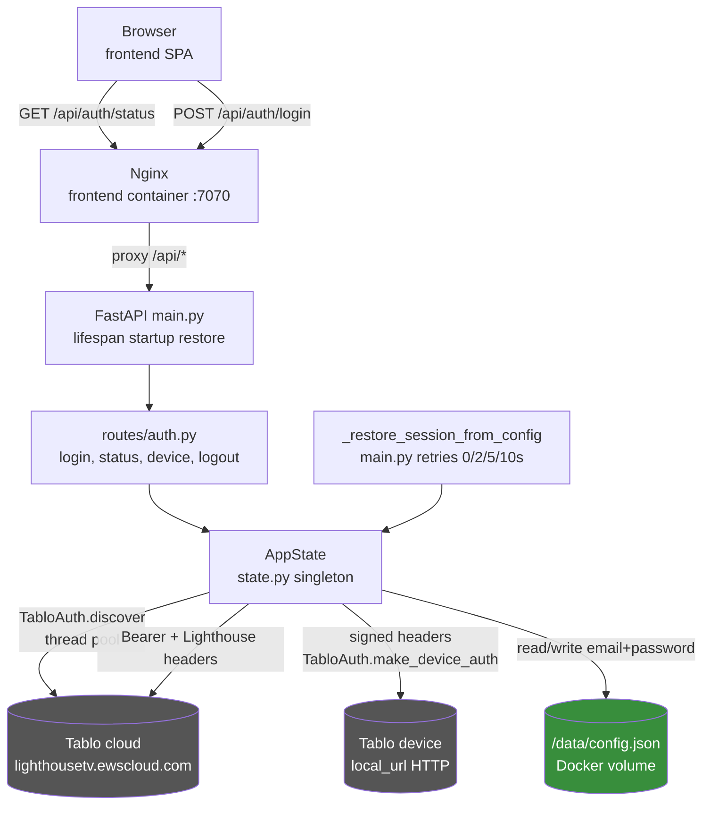

# Authentication & Device Management

## Problem Statement
The Tablo device API is signed per request, and the Tablo cloud account is required to discover which devices belong to the user. The app must authenticate once with the user's Tablo credentials, remember them across container restarts, pick an active device, and then proxy every subsequent device request with valid signed headers.

## Functional Requirements
1. Login with email/password, discover all devices on the account, and auto-select the device when exactly one is found (`backend/app/routes/auth.py` POST `/api/auth/login`, `backend/app/state.py` `AppState.login`).
2. Persist credentials to `/data/config.json` so the session survives container restarts (`state.py` `save_config`, `CONFIG_PATH`).
3. Restore the session at startup from `/data/config.json` with short retries for Tablo cloud timeouts (`backend/app/main.py` `_restore_session_from_config`, delays 0/2/5/10 s).
4. Select the active device by `sid`, invalidating the cached channel list (`auth.py` POST `/api/auth/device/{sid}`, `state.py` `select_device`).
5. Logout: delete the config file and clear all in-memory state including live stream sessions (`auth.py` DELETE `/api/auth/logout`, `state.py` `clear_config`).
6. Report auth status (authenticated, email, device list, active sid) for the frontend boot check (`auth.py` GET `/api/auth/status`).
7. Sign and send authenticated requests to the active local device with a spoofed Tablo mobile User-Agent (`state.py` `request_device`, using `TabloAuth.make_device_auth` from the `tablo-api` package).
8. Build cloud API headers (Bearer account token + Lighthouse token) for OTT data fetches (`state.py` `_cloud_headers`).

## Non-Functional Requirements
- Startup restore retries at 0, 2, 5, and 10 s; after all four failures the app stays unauthenticated and waits for a UI login (`main.py` `_restore_session_from_config`).
- Shared `httpx.AsyncClient` with a 30 s timeout for all device/cloud HTTP (`state.py` `AppState.__init__`); closed in the FastAPI lifespan.
- Exactly one active device at a time; multi-device accounts require an explicit select call.
- Credentials are stored as plaintext JSON in the `/data` volume; only used for Tablo cloud auth and header signing, never returned to the client (password is not in `/api/auth/status`).
- CORS is wide open (`allow_origins=["*"]`) because the app is LAN-scoped and served behind Nginx (`main.py`).
- Blocking `tablo-api` calls (login/discovery, channel list, watch) run in the default thread pool via `_run_sync` so the event loop is not blocked.

## Core Entities
| Entity | Description |
|---|---|
| `TabloAuth` (tablo-api) | Holds email/password; performs cloud discovery and produces signed device headers via `make_device_auth(method, path, body)`. |
| `TabloDevice` (tablo-api) | One Tablo device: `sid`, `name`, `local_url`, plus `account_token` and `lighthouse_token` used for cloud API auth. |
| `config.json` at `/data/config.json` | `{"email": ..., "password": ...}`; the only durable store for auth. |
| `AppState` (`state.py`) | In-process singleton: `auth`, `email`, `devices`, `active_device`, `_channels` cache, `streams` dict, shared `httpx` client. |

## Core API
| Operation | File/Endpoint | Notes |
|---|---|---|
| Auth status | `GET /api/auth/status` (`routes/auth.py`) | Frontend calls this on boot to decide login screen vs. app. |
| Login + discover | `POST /api/auth/login` (`routes/auth.py`) | 401 on bad credentials; schedules guide warm-up on success. |
| Select device | `POST /api/auth/device/{sid}` (`routes/auth.py`) | 404 for unknown sid; invalidates channel cache. |
| Logout | `DELETE /api/auth/logout` (`routes/auth.py`) | Wipes config file + in-memory state. |
| Health | `GET /api/health` (`main.py`) | Container health check, always `{"ok": true}`. |
| Startup restore | lifespan hook (`main.py`) | Not an endpoint; runs `_restore_session_from_config` before the app serves traffic. |
## High-Level Architecture

### How the system satisfies each functional requirement

1. **Login and discovery** is implemented in `routes/auth.py` `login()`, which delegates to `AppState.login()` in `state.py`. `login()` constructs a `TabloAuth`, runs its blocking `discover()` in the thread pool (`_run_sync`), stores the auth object and device list on the singleton, auto-selects the device when there is exactly one, persists credentials, and returns the device list. The route maps exceptions to HTTP 401 and schedules a background guide warm-up so the first guide load is fast.
2. **Persistence** is `AppState.save_config()`, which writes `{"email", "password"}` JSON to `/data/config.json` (parent dirs created). `load_config()` mirrors it on the read side. The `/data` path is a Docker volume in `docker-compose.yml`, so it survives image upgrades and container restarts.
3. **Startup restore** lives in `main.py` `_restore_session_from_config()`, invoked from the FastAPI lifespan. It reads the config file directly, then loops over the delay tuple `(0, 2, 5, 10)` calling `state.login()`; the first success schedules a guide warm-up and stops. Failures are logged with the exception type; after all attempts the app simply stays unauthenticated and the UI shows the login screen.
4. **Device selection** is `AppState.select_device()`: it looks up the sid in the discovered list, raises `ValueError` (mapped to 404) if unknown, sets `active_device`, and nulls `_channels` so the next channel fetch is for the new device.
5. **Logout** is `AppState.clear_config()`: unlink the file, then reset `auth`, `email`, `devices`, `active_device`, `_channels`, and `streams` in one pass, so a stale session cannot outlive the credentials.
6. **Status** is a plain read of the singleton: authenticated flag, email, device sid/name list, and the active sid. The frontend `App.tsx` gates the whole app on this call.
7. **Signed device requests** are centralized in `AppState.request_device()`: it builds the URL from `active_device.local_url`, calls `TabloAuth.make_device_auth(method, path, body)` to produce the `Authorization` and `Date` headers, and sends a spoofed Tablo mobile `User-Agent`. Every device call in the other domain docs flows through this one method.
8. **Cloud headers** come from `_cloud_headers()`, which returns the fixed cloud host plus Bearer account token and Lighthouse token from the active device, used by the guide and IPTV domains for OTT enrichment.

