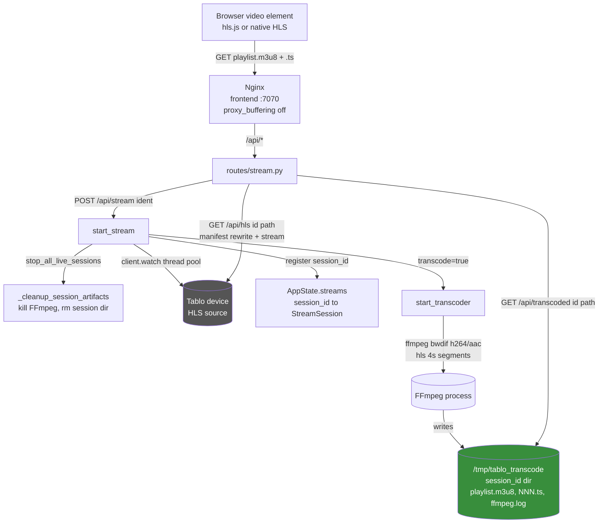

# Live TV Streaming

## Problem Statement
Browsers cannot play the Tablo device's raw HLS directly: OTA channels arrive as MPEG-2 video, which no browser MSE implementation decodes, and the device URL is on the LAN behind signed sessions. The streaming domain gives each viewer a session-scoped proxy path, optionally runs FFmpeg to transcode to H.264 HLS, and serves both paths back to the browser.

## Functional Requirements
1. Start a stream for a channel identifier: open a Tablo watch session, register a session, and return a playable URL (`backend/app/routes/stream.py` `start_stream`, POST `/api/stream/{identifier}`).
2. Single-viewer host semantics: every new tune stops all prior live sessions first, killing their transcoders and wiping their artifacts (`stream.py` `stop_all_live_sessions`).
3. Raw HLS proxy: serve the Tablo playlist and segments under `/api/hls/{session_id}/...`, rewriting manifest entries to point back through the proxy and preserving query tokens (`stream.py` `hls_proxy`, `_rewrite_manifest`).
4. Transcoded HLS: with `?transcode=true`, spawn FFmpeg writing 4-second HLS segments to a per-session directory, served under `/api/transcoded/{session_id}/...` (`stream.py` `start_transcoder`, `transcoded_stream`).
5. Video encoder selection: honor `TABLO_TRANSCODE_ENCODER`, otherwise probe once per process whether `h264_nvenc` actually works at 1080p (the worst case we encode) and fall back to `libx264` (`stream.py` `_resolve_video_encoder`).
6. Stop a stream and clean up all artifacts (FFmpeg process, session directory, state entry) (`stream.py` `stop_stream`, DELETE `/api/stream/{session_id}`, `_cleanup_session_artifacts`).
7. Report transcoder status with the last 20 lines of `ffmpeg.log` (`stream.py` `transcode_status`, GET `/api/transcode/status/{session_id}`).
8. Recover from container restarts: kill orphaned FFmpeg processes and wipe stale session directories at import time (`stream.py` `_startup_cleanup`).

## Non-Functional Requirements
- Max 4 concurrent transcode sessions (`MAX_TRANSCODE_SESSIONS = 4`); the oldest is evicted LRU-style when the cap is hit, preventing CPU exhaustion from zombie transcoders.
- Transcode profile: deinterlace with `bwdif`, H.264 high profile, ~7 Mbps ceiling (`-maxrate 7000k -bufsize 14000k`), AAC stereo 192 k, 4 s segments, `hls_list_size 12`, `delete_segments` so the session dir stays small.
- NVENC is chosen only if the encoder is listed, `/dev/nvidia0` exists, and a 0.5 s test encode at 1920x1080 succeeds; the choice is cached for process life. A busy GPU (for example one shared with a local LLM) may accept a tiny session but fail a 1080p one, which is why the probe encodes at full size.
- If the transcoder dies before writing `playlist.m3u8` (e.g. NVENC could not allocate), the first playlist request restarts it once with `libx264` (`stream.py` `cpu_retry_sessions`); a live transcoder is never restarted mid-startup.
- The first `playlist.m3u8` request waits up to 10 s (20 x 0.5 s polls) for FFmpeg to produce the manifest before 404-ing (and up to 10 s more after a CPU fallback restart).
- Session IDs are hex-validated and segment paths are normalized against the session dir to block path traversal (`transcoded_stream`).
- Nginx disables proxy buffering for `/api/*` and holds HLS connections open for 1 h (`frontend/nginx.conf`), so segments flow without buffering stalls.
- The frontend always requests `transcode=true` for OTA channels because MPEG-2 video is unrenderable in browsers (`frontend/src/components/VideoPlayer.tsx`).

## Core Entities
| Entity | Description |
|---|---|
| `StreamSession` (`state.py`) | In-memory record per viewer: the `TabloStream` (playlist URL, tokens) plus the device base URL derived from the playlist URL. |
| `state.streams` dict | `session_id (uuid4 hex) -> StreamSession`; guarded by a module `Lock`. |
| `transcode_procs` dict (`stream.py`) | `session_id -> subprocess.Popen` for FFmpeg transcoders. |
| `/tmp/tablo_transcode/{session_id}/` | Per-session FFmpeg output: `playlist.m3u8`, `NNN.ts` segments, `ffmpeg.log`. |
| `TabloStream` (tablo-api) | Result of `TabloClient.watch(identifier)`: the device-side live stream with `playlist_url`. |

## Core API
| Operation | File/Endpoint | Notes |
|---|---|---|
| Start stream | `POST /api/stream/{identifier}?transcode=` (`routes/stream.py`) | Stops all prior sessions first; returns `session_id`, `proxy_url`, `stream_url`, `encoder`. |
| Stop stream | `DELETE /api/stream/{session_id}` (`routes/stream.py`) | Kills FFmpeg, removes session dir, drops state entry. |
| Raw HLS proxy | `GET /api/hls/{session_id}/{path}` (`routes/stream.py`) | Manifests rewritten; segments streamed with Range support. |
| Transcoded HLS | `GET /api/transcoded/{session_id}/{path}` (`routes/stream.py`) | Serves files from `/tmp/tablo_transcode/{session_id}/`; playlists return 200, not 206. |
| Transcode status | `GET /api/transcode/status/{session_id}` (`routes/stream.py`) | Process state, file list, last 20 log lines. |
## High-Level Architecture

### How the system satisfies each functional requirement

1. **Start a stream** is `start_stream()` in `routes/stream.py`. It authenticates, calls `stop_all_live_sessions()` for single-viewer semantics, then `state.start_stream(identifier)` which runs `TabloClient.watch` in the thread pool, derives the device base URL from the returned `playlist_url` (so segments use the correct port), and registers a `StreamSession` under a `uuid4` hex id. The response returns both a raw proxy URL and, when transcoding, a `/api/transcoded/.../playlist.m3u8` URL plus the chosen encoder.
2. **Single-viewer semantics** come from `stop_all_live_sessions()`, which walks `state.streams` and any orphaned `transcode_procs` entries and runs `_cleanup_session_artifacts()` on each. This avoids duplicate Tablo watch sessions piling up when the user changes channels quickly.
3. **Raw HLS proxy** is `hls_proxy()`. For `playlist.m3u8` it targets the session's real playlist URL; for segments it rebuilds the device URL from the base and preserves the query string so signed tokens survive. `_rewrite_manifest()` rewrites every manifest entry to `/api/hls/{session_id}/...`, keeping path and query. Segments are streamed chunk-by-chunk with `Range` forwarding and correct `video/mp2t` MIME for iOS.
4. **Transcoded HLS** is `start_transcoder()`. It evicts the oldest session at the cap, creates the session dir, resolves the encoder, and spawns FFmpeg with a deinterlace filter and the H.264/AAC profile writing 4 s segments to `playlist.m3u8`. `transcoded_stream()` serves those files, special-casing `.m3u8` (200 + no-cache) vs `.ts` (FileResponse).
5. **Encoder selection** is `_resolve_video_encoder()`, cached in a module global. It honors `TABLO_TRANSCODE_ENCODER` (`libx264`/`nvenc`), and in auto mode only trusts NVENC if the encoder exists, `/dev/nvidia0` is present, and a 0.5 s test encode returns 0; otherwise it falls back to `libx264`.
6. **Stop + cleanup** is `stop_stream()` calling `_cleanup_session_artifacts()`, which pops the Popen and kills it (waiting up to 3 s), removes the session dir, and drops the state entry. It is idempotent.
7. **Status** is `transcode_status()`, which reports process liveness/return code, the session dir file list, and the last 20 lines of `ffmpeg.log`.
8. **Restart recovery** is `_startup_cleanup()`, run at module import: it `pgrep`s for `tablo_transcode` and SIGKILLs matches, then wipes every directory under `/tmp/tablo_transcode`, clearing orphans left by a previous container run.

