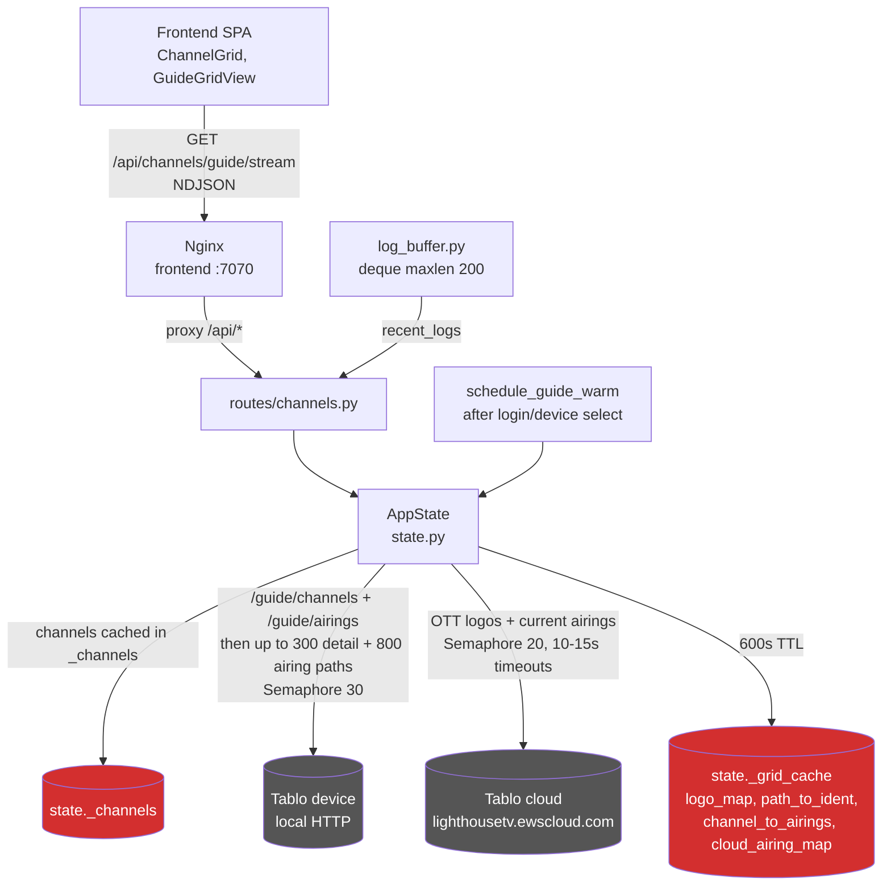

# Channels & TV Guide

## Problem Statement
The Tablo device exposes its catalog as lists of URL paths: `/guide/channels` returns per-channel detail paths and `/guide/airings` returns per-airing detail paths, each requiring its own HTTP call. Building a usable "what's on now" or timeline view means fanning out to hundreds of detail requests, and OTT (FAST) channel data lives in the Tablo cloud rather than on the device. This domain aggregates, caches, and streams that data to the frontend.

## Functional Requirements
1. List channels (OTA + OTT) with optional refresh and OTT filtering (`backend/app/routes/channels.py` GET `/api/channels`, `backend/app/state.py` `AppState.channels`).
2. Provide a "now" guide: every channel with logo and current program (`channels.py` GET `/api/channels/guide`, `state.py` `get_guide_data`).
3. Stream the now-guide as NDJSON in phases so the UI renders immediately: bare stubs, then cloud logos, then full enrichment (`channels.py` GET `/api/channels/guide/stream`, `state.py` `stream_guide_data`).
4. Provide a traditional grid guide with multiple upcoming airings per channel, cached for 10 minutes (`channels.py` GET `/api/channels/guide-grid` and `/guide-grid/stream`, `state.py` `get_grid_guide`, `stream_grid_guide_data`, `_build_grid_enrichment`).
5. Enrich from the Tablo cloud: OTT channel logos and current airings via the Lighthouse API (`state.py` `_fetch_cloud_channels`, `_fetch_cloud_airings`, `_fetch_cloud_data`).
6. Enrich from the device: channel detail (logos) and airing detail fan-out with bounded concurrency (`state.py` `_fetch_guide_enrichment_local`, `_build_grid_enrichment`).
7. Serve a server-side diagnostics report for bug reports, including recent log lines (`channels.py` GET `/api/channels/debug-report`, `backend/app/log_buffer.py`).
8. Pass through raw device endpoints for the local guide, server info, channel detail, and airings (`channels.py` `/local-guide`, `/server-info`, `/detail`, `/airings` via `state.request_device`).

## Non-Functional Requirements
- Grid enrichment results are cached for 600 s (`_GRID_CACHE_TTL`) behind an `asyncio.Lock`; repeated guide loads within the window return the cache without touching the device. The EPG build (`max_airings=15000`) bypasses the cache.
- Local fan-out is capped: at most 300 channel detail paths and 800 airing detail paths for the standard guide (1000 for grid, 15000 for EPG), each behind an `asyncio.Semaphore(30)`.
- Cloud OTT airings are fetched with `asyncio.Semaphore(20)` and a 10 s per-request timeout; cloud channel fetch uses a 15 s timeout. Any cloud failure degrades to empty maps, never failing the whole guide.
- Streaming endpoints send `X-Accel-Buffering: no` and `Cache-Control: no-cache` so Nginx flushes NDJSON lines as they are produced; Phase 2/3 enrichment has a 90 s hard timeout.
- When the grid cache is warm, the streaming endpoint skips Phase 1 stubs so they do not clobber data the frontend already holds.
- A cold-and-idle guide warm-up (`state.schedule_guide_warm`) runs one background enrichment after login/device select, only when no cache and no active streams exist.
- The diagnostics report contains no PII: version, platform, auth shape, active stream count, and the last 200 log lines from an in-memory ring buffer (`log_buffer.py` `deque(maxlen=200)`).

## Core Entities
| Entity | Description |
|---|---|
| `TabloChannel` (tablo-api) | Channel record: `identifier`, `call_sign`, `major`, `minor`, `network`, `kind` (`ota`/`ott`), `display_name`. |
| Guide row (dict) | Channel fields + `logo_url` + `current_program` + `next_program` + channel attributes (`resolution`, `favourite`). Program shape: title, description, start, duration, genres, kind, qualifiers, episode identity. |
| Grid row (dict) | Channel fields + `logo_url` + `airings` list (same program shape, sorted by start). |
| `_grid_cache` (`state.py`) | Cached `(logo_map, path_to_ident, channel_to_airings, cloud_airing_map)` tuple with monotonic timestamp; 600 s TTL. |
| `recent_logs` (`log_buffer.py`) | `deque(maxlen=200)` of formatted log lines fed by a logging handler installed at startup. |

## Core API
| Operation | File/Endpoint | Notes |
|---|---|---|
| List channels | `GET /api/channels?refresh=&include_ott=` (`routes/channels.py`) | Cached in `state._channels`; `refresh=true` forces re-fetch. |
| Now guide | `GET /api/channels/guide` (`routes/channels.py`) | One-shot, full enrichment per call. |
| Now guide stream | `GET /api/channels/guide/stream` (`routes/channels.py`) | NDJSON phases: stubs, cloud logos, enriched rows. |
| Grid guide | `GET /api/channels/guide-grid` (`routes/channels.py`) | Uses 600 s cache. |
| Grid guide stream | `GET /api/channels/guide-grid/stream` (`routes/channels.py`) | NDJSON: stubs immediately, enriched rows after (90 s cap). |
| Library | `GET /api/channels/library` (`routes/channels.py`) | See 04-library.md. |
| Diagnostics report | `GET /api/channels/debug-report` (`routes/channels.py`) | Server diagnostics + recent logs, no PII. |
| Local guide passthrough | `GET /api/channels/local-guide` (`routes/channels.py`) | Raw `/guide/channels` from the device. |
| Server info passthrough | `GET /api/channels/server-info` (`routes/channels.py`) | Raw `/server/info` from the device. |
| Channel detail passthrough | `GET /api/channels/detail?path=` (`routes/channels.py`) | Validates path starts with `/` and has no `://`. |
| Airings passthrough | `GET /api/channels/airings` (`routes/channels.py`) | Raw `/guide/airings` from the device. |

## Enriched fields

Guide, grid, and stream rows carry extra display fields beyond the raw device data. All are optional on the frontend types; the UI hides a line when the data is absent.

| Field | Where | Source | Used for |
|---|---|---|---|
| `episode_title`, `season_number`, `episode_number` | program shape (guide, grid airings, recordings) | Device airing/recording detail `episode` object (`state.py` `_episode_fields`) | "S38 E4 · Title" line via `episodeLabel` in ChannelCard, GuideGridView, LibraryView. |
| `qualifiers` | program shape | Device airing top-level list or cloud `qualifierTags`; int bitmasks normalized to `[]` (`_qualifiers_for`) | LIVE/CC badges on ChannelCard. |
| `resolution` | channel-level | Device channel detail (`c_info`) | HD badge on ChannelCard. |
| `favourite` | channel-level | Device channel detail (`c_info`) | Favourite star badge on ChannelCard. |
| `next_program` | guide rows | `_next_airing`: earliest airing starting strictly after now, from the same airings list as `current_program` | "Next HH:MM · Title" line on ChannelCard. |
| `genres` | program shape | Device airing detail; falls back to event-type-derived genre (`_EVENT_GENRES`: movieAiring/sportEvent/newsEvent) when the device sends none | Content filters in `lib/filters.ts`. |

Frontend search and filter logic is shared in `frontend/src/lib/filters.ts` (`matchesContentFilter`, `channelMatchesFilter`, `airingMatchesFilter`, `guideRowMatchesSearch`, `gridRowMatchesSearch`, `recordingMatchesSearch`, `episodeLabel`) so all tabs match the same fields.

## High-Level Architecture

### How the system satisfies each functional requirement

1. **Channel list** is `GET /api/channels` in `routes/channels.py`, backed by `AppState.channels()`. The list is memoized in `_channels` and only re-fetched on `refresh=true`, after login, or after a device switch (both of which null the cache). `include_ott` is passed through to `TabloClient.channels` so the UI can filter OTA vs FAST.
2. **Now guide** is `get_guide_data()`: it resolves the channel list, runs `_fetch_guide_enrichment()` to build logo and current-airing maps, then for each channel looks up its local path via `path_to_ident` (reverse of path-to-identifier) and picks the local current airing or falls back to the cloud one. The result is a flat list of guide rows.
3. **Now guide stream** is `stream_guide_data()`, an async generator. Phase 1 yields bare channel stubs (skipped when the grid cache is warm, to avoid clobbering). Phase 2 fetches only cloud logos and yields rows with `logo_url` filled in. Phase 3 awaits `_build_grid_enrichment()` under a 90 s timeout and yields fully enriched rows with `current_program`. The frontend merges rows by `identifier`, so each phase improves the previous one.
4. **Grid guide** is `get_grid_guide()` / `stream_grid_guide_data()`. Both call `_build_grid_enrichment(max_airings=1000)`, which is the cached path: on a cache hit it returns the stored tuple instantly; on a miss it fans out to the device and cloud, builds `channel_to_airings` keyed by local channel path, and stores the result with a monotonic timestamp for the 600 s TTL. `_assemble_grid_row()` attaches the sorted airings list (or the cloud current program for OTT channels with no local airings) to each channel.
5. **Cloud enrichment** is `_fetch_cloud_data()` = `_fetch_cloud_channels()` (one request to the Lighthouse `guide/channels/` endpoint, extracting logos and identifiers) followed by `_fetch_cloud_airings()` (one request per identifier for current airings, `Semaphore(20)`, 10 s timeout). Both return empty maps on any exception so a cloud outage never blocks the local guide.
6. **Device enrichment** is `_build_grid_enrichment()`: it gathers `/guide/channels` and `/guide/airings` (plus cloud data) in parallel, then fans out to at most 300 channel detail paths and the requested number of airing paths, each under `Semaphore(30)`. Detail responses yield logos (`originalLarge` preferred, `lightLarge` fallback) and the path-to-identifier mapping; airing responses are filtered to those currently on air for the now-guide maps, or kept as full airing lists for the grid.
7. **Diagnostics report** is `GET /api/channels/debug-report`, which assembles Python/platform info, auth shape (no email or password), active stream count, and the `recent_logs` deque contents. `log_buffer.py` installs a logging handler at import that appends formatted records to the 200-line ring buffer.
8. **Passthroughs** are thin: each validates auth, optionally validates the path argument (`/detail` requires a leading `/` and no `://`), and returns `state.request_device(...)` JSON directly, mapping device errors to 502.

