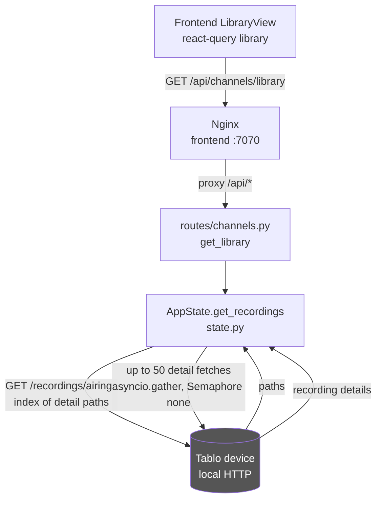

# Library (Recordings)

## Problem Statement
The Tablo device stores recorded programs locally and exposes them only through per-recording detail paths. The web UI needs a browsable recordings list, so this domain fetches the recording index from the device, fans out to individual recording details, and returns a flat list the frontend can render.

## Functional Requirements
1. List recordings: fetch the recording index from the device and return enriched rows (`backend/app/routes/channels.py` GET `/api/channels/library`, `backend/app/state.py` `AppState.get_recordings`).
2. Enrich each recording with display fields (title, description, start, duration) from its detail path (`state.py` `get_recordings` inner `fetch_recording`).
3. Render the recordings list in the Library tab with loading, error, and refetch states (`frontend/src/components/LibraryView.tsx`, query key `["library"]`).

## Non-Functional Requirements
- Only the first 50 recordings are fetched (`paths[:50]`) to keep the response snappy; the device may hold many more.
- Fan-out is unbounded in concurrency (`asyncio.gather` over all 50) but each request uses the shared 30 s-timeout `httpx` client via `state.request_device`.
- A failed detail fetch returns `None` for that recording and is filtered out, so one bad recording never fails the whole list. If the index fetch itself fails, the endpoint returns `[]` (empty library) rather than an error.
- No caching: the library re-queries the device on every call; the frontend can refetch on demand.
- `thumbnail` is currently always `None`; series image resolution is a noted TODO in `state.py`.

## Core Entities
| Entity | Description |
|---|---|
| Recording row (dict) | `identifier` (device `object_id`), `path` (detail path), `title`, `description`, `start`, `duration`, `thumbnail` (always null today), plus episode identity (`episode_title`, `season_number`, `episode_number` via `_episode_fields`). |
| `Recording` (frontend type) | TypeScript interface in `frontend/src/api/tablo.ts` mirroring the row shape. |
| Device `/recordings/airings` | The device endpoint returning the list of recording detail paths. |

## Core API
| Operation | File/Endpoint | Notes |
|---|---|---|
| List recordings | `GET /api/channels/library` (`routes/channels.py`) | 502 on unexpected error; `[]` when the device index is empty or unreachable. |
| Device index (upstream) | `GET /recordings/airings` on the Tablo device | Returns recording detail paths; fetched via `state.request_device`. |
| Recording detail (upstream) | `GET {path}` on the Tablo device | One call per recording, up to 50, in parallel. |

## High-Level Architecture

### How the system satisfies each functional requirement

1. **List recordings** is `get_recordings()` in `state.py`, exposed by `get_library()` in `routes/channels.py`. It first calls `state.request_device("GET", "/recordings/airings")` to get the list of recording detail paths. If that call fails, it returns an empty list so the UI shows an empty library instead of an error.
2. **Enrichment** happens in the inner `fetch_recording(path)` coroutine: it GETs each detail path, reads `airing_details` for `show_title`, `datetime`, and `duration`, pulls the description from `episode.description` falling back to `series.description`, and attaches episode identity via `_episode_fields`. The returned row carries the device `object_id` as `identifier` and the original `path` so the frontend could later deep-link or fetch media.
3. **Frontend rendering** is `LibraryView.tsx`, a TanStack Query component keyed `["library"]` that calls `api.library()`. It exposes `isLoading`, `isError`, and `refetch` for the Library tab UI. The `Recording` type in `api/tablo.ts` matches the backend row shape. The view applies the shared header search via `recordingMatchesSearch` from `lib/filters.ts`, renders an "S/E · Title" line via `episodeLabel` when episode data is present, and shows a disabled play button (playback not yet wired up).
