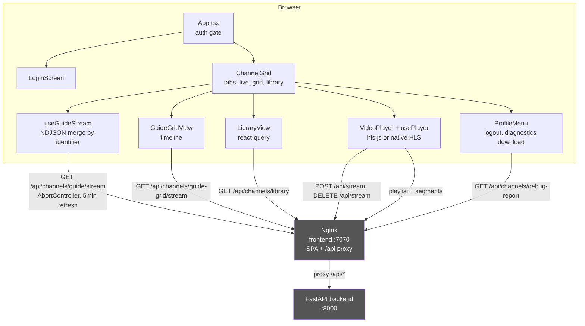

# Frontend UI

## Problem Statement
The frontend is a single-page React app that presents live TV, a traditional guide, and the recordings library in one interface. It must consume the backend's phased NDJSON streams without clobbering already-rendered data, adapt HLS playback to browser capabilities (hls.js vs native), and be served by the same Nginx container that proxies the API.

## Functional Requirements
1. Gate the app on auth status: show a spinner, then either the login screen or the main grid (`frontend/src/App.tsx`, `frontend/src/components/LoginScreen.tsx`).
2. Render the live channel grid from a phased NDJSON stream, merging rows by identifier and preserving existing logo/program data when a bare stub arrives (`frontend/src/components/ChannelGrid.tsx` `useGuideStream`).
3. Filter the grid by content type (movies, sports, news, reality, documentary, broadcast, streaming) using the current program's kind and genres (`frontend/src/lib/filters.ts` `matchesContentFilter`, `channelMatchesFilter`, `airingMatchesFilter`).
4. Search across all tabs from the header: live rows match call sign/network/display name/current title, grid rows also match any airing title, library recordings match title/description (`lib/filters.ts` `guideRowMatchesSearch`, `gridRowMatchesSearch`, `recordingMatchesSearch`).
5. Render the traditional timeline guide from the grid NDJSON stream (`frontend/src/components/GuideGridView.tsx`).
6. Render the recordings library with loading, error, and refetch states (`frontend/src/components/LibraryView.tsx`).
7. Play a channel: start a stream (always transcoding OTA), load it into the video element via hls.js or native HLS, and stop the stream on unmount (`frontend/src/components/VideoPlayer.tsx`, `frontend/src/hooks/usePlayer.ts`).
8. Provide player controls: mute, volume slider (ArrowUp/ArrowDown), fullscreen (iOS-aware), auto-hiding overlay, and keyboard shortcuts (`VideoPlayer.tsx`).
9. Offer a profile menu with logout and a downloadable server diagnostics report (`frontend/src/components/ProfileMenu.tsx`).
10. Expose a typed API client for all backend endpoints, including the NDJSON stream consumer (`frontend/src/api/tablo.ts`).

## Non-Functional Requirements
- The live guide stream is re-opened every 5 minutes (`setInterval(..., 300_000)` in `ChannelGrid.tsx`), aligned with the backend 10-minute grid cache; programs last at least 30 minutes so the refresh cadence is safe.
- NDJSON consumption uses an `AbortController` so a new stream aborts the previous one; rows are merged into a `Map` keyed by identifier so re-renders are incremental (`api/tablo.ts` `ndjsonStream`, `ChannelGrid.tsx`).
- hls.js is configured for LAN stability over lowest latency: `lowLatencyMode: false`, `maxBufferLength: 30`, `maxMaxBufferLength: 60`, `liveSyncDurationCount: 3`, `liveMaxLatencyDurationCount: 10`, `backBufferLength: 90`, 20 s load timeouts with 10 retries (`usePlayer.ts`).
- Native HLS is used only on iOS Safari (detected including iPadOS-as-Mac, excluding Chrome-for-iOS); all other browsers use hls.js so MPEG-2 TS is handled (`usePlayer.ts`).
- OTA channels always request `transcode=true` because no browser MSE decodes MPEG-2 video (`VideoPlayer.tsx`).
- Player controls auto-hide after 3.5 s and reappear on interaction; keyboard: Esc/q close, f fullscreen, m mute.
- Nginx never caches `index.html` (so new hashed bundles are picked up) but allows indefinite caching of hashed assets, and disables proxy buffering for `/api/*` (`frontend/nginx.conf`).

## Core Entities
| Entity | Description |
|---|---|
| `Channel`, `GuideChannel`, `GridChannel`, `Recording`, `StreamStart`, `AuthStatus`, `DebugReport` | TypeScript interfaces in `api/tablo.ts` mirroring backend row shapes. |
| `api` object (`api/tablo.ts`) | Typed fetch client: auth, channels, guide/grid (one-shot + stream), library, stream start/stop, diagnostics report. |
| `ndjsonStream<T>` (`api/tablo.ts`) | Async generator that reads a fetch body, splits on newlines, buffers partial lines, and yields parsed JSON objects. |
| `lib/filters.ts` | Shared pure functions: content filters (`matchesContentFilter`, `channelMatchesFilter`, `airingMatchesFilter`), per-surface search matchers (`guideRowMatchesSearch`, `gridRowMatchesSearch`, `recordingMatchesSearch`), and `episodeLabel` ("S38 E4 · Title"). Used by ChannelCard, ChannelGrid, GuideGridView, and LibraryView. |
| `usePlayer` hook state | hls.js instance ref, native error handler ref, and an `error` string surfaced to the UI. |
| React Query client (`App.tsx`) | Global `QueryClient` wrapping the app; used by the library view and cleared on logout. |

## Core API
| Operation | File/Function | Notes |
|---|---|---|
| Auth status | `api.status()` -> `GET /api/auth/status` | Boot gate in `App.tsx`. |
| Login | `api.login(email, password)` -> `POST /api/auth/login` | Used by `LoginScreen`. |
| Select device | `api.selectDevice(sid)` -> `POST /api/auth/device/{sid}` | Multi-device accounts. |
| Logout | `api.logout()` -> `DELETE /api/auth/logout` | Clears the React Query cache too. |
| Channels | `api.channels(refresh?)` -> `GET /api/channels` | One-shot channel list. |
| Now guide stream | `api.guideStream(signal?)` -> `GET /api/channels/guide/stream` | NDJSON, consumed by `useGuideStream`. |
| Grid guide stream | `api.guideGridStream(signal?)` -> `GET /api/channels/guide-grid/stream` | NDJSON, consumed by `GuideGridView`. |
| Library | `api.library()` -> `GET /api/channels/library` | React Query in `LibraryView`. |
| Start stream | `api.startStream(identifier, transcode?)` -> `POST /api/stream/{identifier}` | OTA forces `transcode=true`. |
| Stop stream | `api.stopStream(sessionId)` -> `DELETE /api/stream/{sessionId}` | Called on player unmount. |
| Diagnostics report | `api.debugReport()` -> `GET /api/channels/debug-report` | Downloaded by `ProfileMenu`. |
## High-Level Architecture

### How the system satisfies each functional requirement

1. **Auth gate** is `App.tsx`: on mount it calls `api.status()` and holds a three-state flag (`null` = loading spinner, `false` = `LoginScreen`, `true` = `ChannelGrid`). Logout clears the React Query cache and resets the flag. The whole app is wrapped in a single `QueryClientProvider`.
2. **Live grid** is `useGuideStream` in `ChannelGrid.tsx`. It opens `api.guideStream()` (an NDJSON async generator), and for each incoming row merges it into a `Map` keyed by identifier, preserving the existing `logo_url`/`current_program` when the incoming row is a bare Phase 1 stub. State updates re-render incrementally; a 5-minute `setInterval` re-opens the stream, and an `AbortController` cancels the previous one.
3. **Content filters** are `matchesContentFilter()` (live rows), `channelMatchesFilter()` (grid rows, any airing today), and `airingMatchesFilter()` (per-airing genre match) in `lib/filters.ts`, driven by the `CONTENT_FILTERS` chips. Filters match on `channel.kind` for broadcast/streaming, and on program `kind`/`genres` for movies, sports, news, reality, and documentary; channels with no current program are hidden by genre filters.
4. **Header search** is one shared input in `ChannelGrid.tsx`; the query is passed to `GuideGridView` and `LibraryView` as a prop, and each surface filters with its matching helper from `lib/filters.ts` (`guideRowMatchesSearch`, `gridRowMatchesSearch`, `recordingMatchesSearch`). Matching is case-insensitive substring over the fields listed in requirement 4.
5. **Timeline guide** is `GuideGridView.tsx`, which consumes `api.guideGridStream()` the same way and lays out channels as rows with airing blocks positioned by start/duration. Airing buttons show an `episodeLabel` line when episode data is present, and channel headers show the network.
6. **Library** is `LibraryView.tsx`, a TanStack Query component keyed `["library"]` that renders the `Recording` list with loading, error, and refetch handling, applies the header search, and shows an `episodeLabel` line per recording.
7. **Playback** is `VideoPlayer.tsx` + `usePlayer.ts`. On mount the player decides `transcode = channel.kind === "ota"` (MPEG-2 video is unrenderable in browsers), calls `api.startStream`, and loads the returned `stream_url`. `usePlayer.load()` prefers hls.js with a LAN-tuned config, falls back to native HLS only on iOS Safari, and surfaces fatal errors as UI state. Unmount destroys the player and DELETEs the session so the backend tuner is released. The overlay also renders a now-playing bar (title, start time, description, progress with elapsed/total readouts driven by a 10 s tick) and a Transcoding chip for OTA channels.
8. **Controls** live in `VideoPlayer.tsx`: mute toggle, iOS-aware fullscreen (`webkitEnterFullscreen` when present), a 3.5 s auto-hide timer for the overlay, and a window keydown handler for Esc/q, f, and m.
9. **Profile menu** is `ProfileMenu.tsx`, which offers logout and a download of `api.debugReport()` as a JSON file for bug reports.
10. **Typed API client** is `api/tablo.ts`: a `req<T>` fetch wrapper that throws on non-2xx with the backend's `detail` message, plus `ndjsonStream<T>` which buffers partial lines across chunk boundaries and yields parsed objects. All interfaces (`Channel`, `GuideChannel`, `GridChannel`, `Recording`, etc.) mirror the backend row shapes, including the enriched episode/qualifier/channel-attribute fields.

